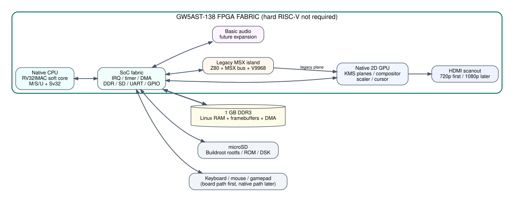
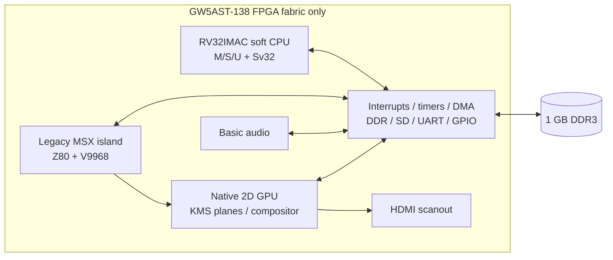
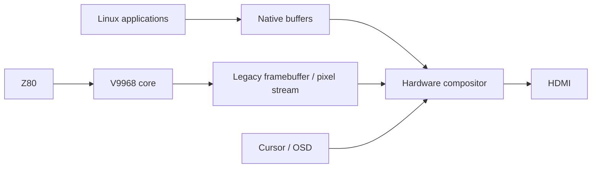
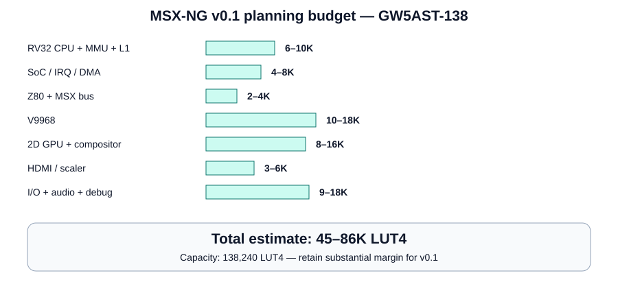
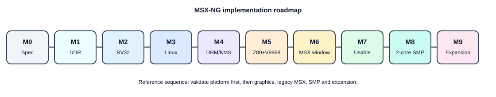

# MSX-NG

**MSX-NG** is a specification-first project for a new FPGA-native computer that keeps **real MSX compatibility in hardware** while adding a modern **soft RISC-V Linux environment** and a native graphical desktop.

The reference development target is the **Sipeed Tang Console / Tang Mega 138K (GW5AST-138)**, but the architecture is intentionally designed so that the mandatory core can later be ported to a **GW5A/GW5AT-60K** or to the **programmable logic of a Xilinx Zynq-7020**, without relying on the hard RISC-V or ARM CPUs of those devices.

> Status: **architecture / bring-up specification**. No MSX-NG RTL has been declared production-ready yet.



## Design goals

1. **FPGA-native machine** - the main CPU, legacy Z80, VDP and graphics pipeline are synthesized logic.
2. **Linux-capable native mode** - RV32 soft CPU with MMU, S-mode and enough platform logic to boot Linux.
3. **Hardware MSX compatibility** - Z80 + V9968-class VDP remain hardware blocks, not a software emulator.
4. **MSX in a window** - the legacy VDP output becomes a hardware plane/framebuffer composited into the Linux desktop.
5. **Portable standard** - the mandatory MSX-NG profile must not depend on GW5AST hard RISC-V or Zynq ARM cores.
6. **Scalable** - one core first, SMP later; 2D graphics first, optional 3D later; one FPGA first, multi-FPGA later.
7. **Inspectable and hackable** - stable memory map, documented registers, open device-tree bindings and testable interfaces.

## Baseline system



## Standard profiles

| Profile | Target | Native CPU | Legacy | Graphics | Intended use |
|---|---|---|---|---|---|
| **NG-Base** | ~60K class | 1x RV32 Linux core | Z80 + V9968 | 2D + compositor | Minimum portable machine |
| **NG-Reference** | 138K | 1-2 RV32 cores | Z80 + V9968 | 2D + multi-plane KMS | Main development target |
| **NG-Plus** | 138K / multi-FPGA | 2-4 cores | Z80 + V9968 | 2D + optional RasterIX 3D | Future expansion |

## CPU standard - first target

The native CPU is a **soft-core**. The first Linux-capable profile targets:

- ISA: **RV32IMAC**
- Mandatory system extensions: **Zicsr**, **Zifencei**
- Privilege: **M / S / U**
- MMU: **Sv32**
- Atomic instructions: mandatory for the SMP profile
- Separate instruction/data caches
- Machine timer + software interrupts
- external interrupt controller
- debug/JTAG strongly recommended
- implementation must remain vendor-neutral above the memory/PLL/IO wrapper layer

The standard specifies the software-visible contract. The first bring-up may use **VexRiscv/VexRiscv-SMP as a golden reference**, while the long-term MSX-NG CPU can evolve into a custom implementation with the same architectural contract.

See [CPU standard](docs/03-cpu-standard.md).

## Linux choice

**Recommended first OS stack:**

```text
Boot ROM -> OpenSBI -> Linux -> Buildroot rootfs -> Wayland/Weston or MSX-NG shell
```

Why Buildroot:

- excellent fit for RV32 FPGA systems;
- reproducible cross compilation;
- small root filesystem;
- can include BusyBox, SDL2, Wayland, Weston, Qt/GTK subsets, networking and development tools;
- no need to maintain a new kernel or operating system from scratch.

RV32 does **not** give the same prebuilt desktop-package ecosystem as mainstream x86-64/RV64 Linux. MSX-NG therefore treats Buildroot as the reference distribution and cross-compiles the applications we want.

See [Linux software stack](docs/07-linux.md).

## Graphics model

MSX-NG does **not** ask the native GPU to emulate the V9968.



The native graphics block initially provides:

- framebuffer scanout;
- RGB565 / XRGB8888 / ARGB8888;
- multiple hardware planes;
- legacy-MSX overlay plane;
- cursor plane;
- scaling;
- alpha blending;
- rectangle fill/copy and optional 2D blitter.

**RasterIX/OpenGL ES is optional and explicitly not required for v0.1.**

See [Graphics architecture](docs/05-graphics.md).

## Legacy MSX island

The compatibility subsystem is a hardware island:

```text
Z80 soft core -> MSX bus fabric -> V9968 -> legacy framebuffer
                     |              |
                  BIOS/ROM        VRAM
```

Linux controls it through registers and shared memory, allowing:

- reset/start/stop/pause;
- ROM and disk mounting;
- full-screen/windowed display;
- screenshots;
- save-state hooks later;
- shared files and virtual peripherals later.

The initial implementation should reuse lessons from **MSXimus_138** but remain a separate architecture.

See [Legacy MSX subsystem](docs/06-legacy-msx.md).

## Memory

Reference 138K board: **1 GB DDR3**. The DDR is the main RAM for Linux, framebuffers, graphics buffers and legacy resources. BSRAM is reserved for caches, FIFOs, boot ROM, line buffers and low-latency structures.

Proposed physical map:

| Range | Function |
|---|---|
| `0x0000_0000-0x0000_FFFF` | boot ROM / tightly-coupled BRAM |
| `0x1000_0000-0x10FF_FFFF` | core SoC MMIO |
| `0x1100_0000-0x11FF_FFFF` | native GPU / display |
| `0x1200_0000-0x12FF_FFFF` | legacy MSX control |
| `0x1300_0000-0x13FF_FFFF` | audio |
| `0x1400_0000-0x14FF_FFFF` | SD / GPIO / board I/O |
| `0x2000_0000-0x2FFF_FFFF` | expansion window |
| `0x8000_0000-0xBFFF_FFFF` | up to 1 GB DDR3 |

See [Memory map](docs/04-memory-map.md).

## Resource planning - 138K first prototype

These are **engineering budgets, not synthesis results**.

| Block | Planning range |
|---|---:|
| RV32 Linux CPU + MMU + caches | 6-10K LUT |
| SoC fabric / timers / IRQ / DMA | 4-8K |
| DDR / board glue | 3-6K |
| Z80 + MSX bus | 2-4K |
| V9968 subsystem | 10-18K |
| native 2D GPU / compositor | 8-16K |
| HDMI / scanout / scaler | 3-6K |
| SD / UART / basic I/O | 3-6K |
| basic audio | 2-4K |
| debug / boot / margin | 4-8K |
| **Expected first system** | **45-86K LUT** |

On a 138,240-LUT device this leaves substantial margin. The range is deliberately conservative until the first synthesis campaign.



See [Resource budget](docs/08-resource-budget.md).

## Tang Console 138K implementation plan

The first hardware bring-up should use the board already available and should **not** begin by integrating everything at once.



1. Board identification and toolchain lock.
2. Clock/PLL smoke test.
3. DDR3 calibration + destructive memory test.
4. UART + timer + interrupt controller.
5. Single RV32 soft CPU running bare metal.
6. MMU + S-mode + OpenSBI.
7. Linux kernel console boot.
8. Buildroot initramfs/rootfs.
9. HDMI framebuffer.
10. DRM/KMS + basic Linux desktop.
11. Z80 + V9968 island.
12. V9968 as a compositor plane/window.
13. SD/input/audio.
14. Two-core SMP.
15. Optional 3D / expansion.

Detailed acceptance criteria are in [Tang 138K bring-up](docs/09-tang138-bringup.md) and [roadmap](docs/10-roadmap.md).

## Repository layout

```text
MSX-NG/
├── boards/tang-console-138k/  Board notes and constraints strategy
├── docs/                      Architecture and standards
├── rtl/cpu/                   Native soft CPU
├── rtl/legacy/                Z80/MSX/V9968 compatibility island
├── rtl/gpu/                   Native graphics/compositor
├── rtl/soc/                   Interconnect, IRQ, DMA, timers, address map
├── software/buildroot/        Buildroot integration
├── software/linux/            Kernel/device-tree/driver notes
├── software/userspace/        MSX manager / desktop tools
└── scripts/                   Bring-up and test automation
```

## Definition of done for v0.1

v0.1 is complete when a Tang Console 138K can:

- boot using **only FPGA soft CPU logic** for the native CPU;
- pass DDR3 memory testing;
- boot Linux + Buildroot;
- display a graphical Linux desktop/framebuffer through HDMI;
- run at least one native graphical application;
- start a hardware Z80 + V9968 MSX environment;
- show that MSX environment as a movable or composited region on the Linux display;
- switch the legacy environment to full screen;
- run without using the GW5AST hard RISC-V as part of the MSX-NG functional requirement.

## Related existing work

- [Papipapito/MSXimus_138](https://github.com/Papipapito/MSXimus_138) - practical 138K/MSX/V9968/DDR3/HDMI reference.
- [Papipapito/MSXimus](https://github.com/Papipapito/MSXimus) - 60K MSX implementation.
- [LiteX CPU catalog](https://github.com/enjoy-digital/litex/wiki/CPUs) - reference SoC framework and Linux-capable soft CPUs.
- [VexRiscv](https://github.com/SpinalHDL/VexRiscv) - FPGA-oriented RV32 reference core.
- [OpenSBI platform requirements](https://github.com/riscv-software-src/opensbi/blob/master/docs/platform_requirements.md).
- [Buildroot](https://buildroot.org/).
- [RasterIX](https://github.com/ToNi3141/Rasterix) - optional future FPGA 3D rasterizer.

## Sugerencias - uso del RISC-V hard de la 138K fuera del estándar MSX-NG

The **GW5AST hard RISC-V is deliberately not part of the MSX-NG mandatory architecture**. This keeps MSX-NG portable to 60K and Z020-class FPGAs. On a 138K board it can still be extremely useful as an **out-of-band companion processor**:

1. **BMC / service processor** - watchdog, temperatures, fan, voltages, reset and recovery.
2. **Remote debugger** - inspect soft-CPU memory/registers, trace buffers and FPGA status without disturbing Linux.
3. **Recovery/update controller** - reflash bitstreams, maintain A/B images and recover a broken main system.
4. **Network management plane** - SSH/web control, telemetry and remote console independent of the MSX-NG CPU.
5. **Storage/image manager** - background ROM/DSK/image indexing and transfer.
6. **FPGA instrumentation host** - logic-analyzer capture, counters, performance telemetry and crash dumps.
7. **Security boundary experiments** - keep signing/update keys away from the soft CPU.
8. **Development accelerator** - load test programs, reset cores, run manufacturing tests and automate bring-up.
9. **Always-on companion** - preserve clock/network/status services while the soft CPU is reset or reconfigured.

**Rule:** MSX-NG must still boot and operate if this hard processor is unused. It is a complement, not the machine's identity.

See [Hard RISC-V companion suggestions](docs/12-hard-riscv-suggestions.md).
