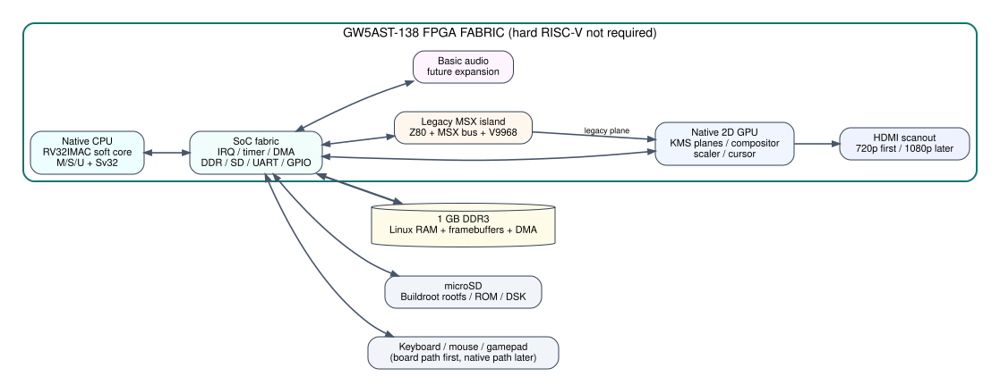

# 02 - System architecture

## Major blocks

### Native CPU complex

- RV32IMAC soft core.
- M/S/U privilege.
- Sv32 MMU.
- I-cache / D-cache.
- one hart first, SMP later.

### SoC fabric

- DDR3 controller and arbiter.
- interrupt controller.
- machine timer / software interrupt.
- DMA.
- SD, UART, GPIO and board control.
- expansion aperture.

### Native graphics

- scanout engine;
- hardware planes;
- 2D compositor;
- cursor;
- scaling and alpha;
- optional blitter.

### Legacy MSX island

- Z80-compatible soft core;
- MSX bus timing;
- BIOS/ROM interfaces;
- V9968-class VDP;
- dedicated or shared VRAM window;
- control registers exposed to Linux.

## Recommended first-clock domains

Keep the first implementation conservative:

| Domain | Initial target | Notes |
|---|---:|---|
| native CPU | 50-75 MHz | increase only after Linux is stable |
| SoC / AXI-Wishbone | 50-75 MHz | same clock as CPU initially |
| DDR controller | vendor IP clock | isolated via FIFOs/bridges |
| pixel clock | 74.25 MHz | 720p60 first |
| V9968 | existing proven clocks | reuse MSXimus_138 lessons |
| Z80 | 3.58 / 5.37 MHz modes | timing compatibility first |

## Single-FPGA first

The first prototype intentionally keeps everything in one 138K. Multi-FPGA separation is a later optimization, not a prerequisite.
