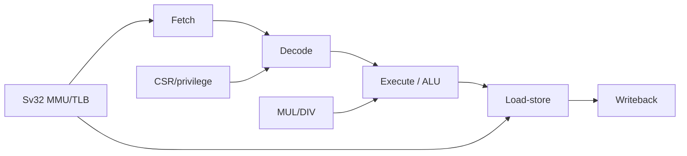

# 03 - Native CPU standard

## Mandatory software-visible profile

**MSX-NG Native CPU v0.1:**

- 32-bit RISC-V.
- RV32IMAC.
- Zicsr and Zifencei.
- Machine, Supervisor and User privilege modes.
- Sv32 MMU.
- page faults and precise exceptions.
- timer interrupt and external interrupts.
- atomic operations for SMP-capable builds.
- little endian.

This is the **architectural contract**, not a mandate for one implementation.

## Bring-up core vs long-term core

### Stage A - known-good reference

Use a Linux-capable FPGA RISC-V such as VexRiscv/VexRiscv-SMP to validate:

- DDR;
- OpenSBI;
- Linux;
- interrupt controller;
- device tree;
- graphics driver;
- legacy bridge.

### Stage B - MSX-NG native CPU

Develop the custom core after the platform works. It should reproduce the same software contract so Linux does not care which RTL core is selected.

Possible microarchitecture:

## Z80 relationship

The initial standard keeps the Z80 as a **separate compatibility core**. A future implementation may share a 32-bit execution engine and translate Z80 instructions into internal micro-ops, but that is an implementation experiment, not a v0.1 dependency.

This avoids putting Linux bring-up on the critical path of a new dual-decoder CPU.

## SMP profile

The first SMP target is 2 harts.

Mandatory additions:

- RV32A atomics;
- coherent memory view;
- inter-hart software interrupts;
- per-hart timers or equivalent;
- cache-coherent DMA strategy or explicit non-coherent DMA rules.

4-hart operation is a 138K-class future target.

## Cache planning

Initial target per hart:

- I-cache: 8-16 KiB;
- D-cache: 8-16 KiB;
- 32/64-byte lines;
- write-back D-cache preferred;
- optional small shared L2 only after SMP is stable.

Use BSRAM for caches and TLBs. Do not waste external DDR bandwidth on structures that must be low-latency.
