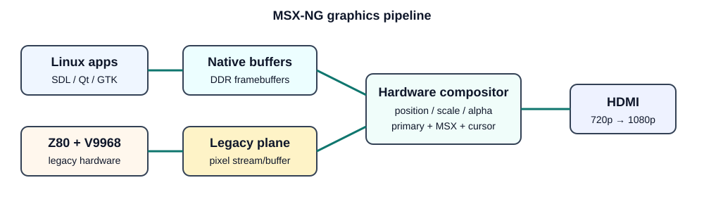
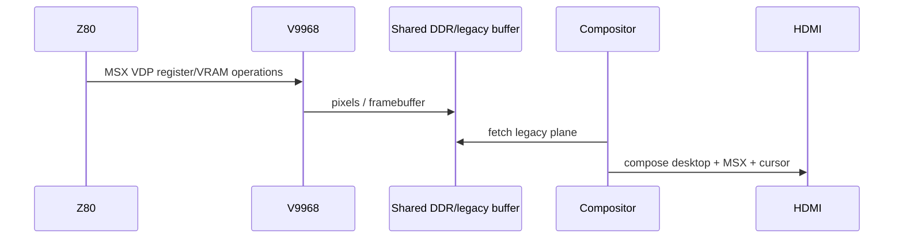

# 05 - Graphics architecture

## Principle

The native GPU does not emulate the V9968. The V9968 remains an independent hardware renderer. Both feed a shared display compositor.

## v0.1 mandatory graphics

- 720p60 HDMI first; 1080p later.
- primary scanout plane.
- legacy MSX plane.
- cursor plane.
- at least one additional overlay plane.
- RGB565 and XRGB8888.
- ARGB8888 for alpha-capable overlays.
- programmable position/size.
- nearest-neighbour scaling first.
- alpha blend.
- optional rectangle copy/fill engine.

## Linux integration path

### Phase 1 - simple framebuffer

Linux draws to a reserved framebuffer and the FPGA scans it out. This is deliberately primitive but proves CPU -> DDR -> HDMI quickly.

### Phase 2 - DRM/KMS

Implement a native DRM/KMS driver exposing:

- connector: HDMI;
- CRTC;
- primary plane;
- legacy overlay plane;
- cursor plane;
- dumb buffers/GEM memory.

This lets Weston/Wayland and native applications use standard Linux display APIs.

### Phase 3 - 2D offload

Expose fill/copy/scale/composite operations through a controlled userspace/driver API. Avoid inventing a full 3D stack before the desktop works.

## Legacy window

Linux can change the plane rectangle without changing Z80/V9968 timing. Fullscreen is simply a compositor mode.

## Optional 3D

RasterIX is a candidate for an optional fixed-function 3D profile. It is not in the base standard because its LUT cost can make 60K/Z020-class implementations too tight and because no 3D is required to prove the MSX-NG concept.
