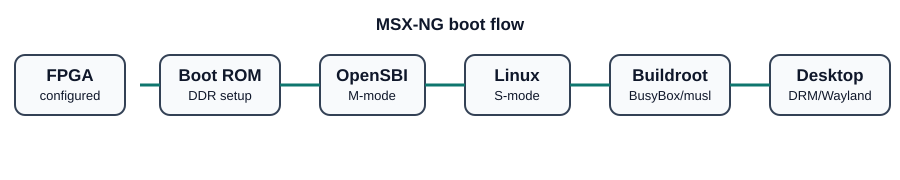

# 07 - Linux / Buildroot software stack



## Recommended stack

**Reference OS:** Linux built by **Buildroot**.

Boot chain:

```text
FPGA config
  -> BRAM boot ROM
  -> OpenSBI (M-mode)
  -> Linux kernel (S-mode)
  -> initramfs or SD root filesystem
  -> BusyBox/init
  -> display/input services
  -> Weston or MSX-NG shell
```

## Why Buildroot instead of Ubuntu/Debian

The project is initially RV32. Buildroot gives a reproducible way to cross-compile the full userspace we choose. Mainstream desktop distributions and binary repositories concentrate much more heavily on x86-64/aarch64/RV64, so promising arbitrary desktop binaries on RV32 would be misleading.

Buildroot can still provide a very capable system:

- BusyBox;
- SSH;
- networking;
- SDL2;
- Wayland/Weston;
- lightweight Qt/GTK applications where packages build for RV32;
- Python if resources permit;
- file managers/editors/terminal tools;
- custom MSX-NG applications.

## libc choice

Start with **musl** for small images and easy bring-up. If a later application set requires glibc, maintain a glibc profile as an alternate build.

## Kernel strategy

Keep the kernel as close to upstream as practical. Put platform-specific work in:

- device tree;
- clock/irq/timer drivers if required;
- DDR exposure;
- DRM/KMS driver;
- legacy MSX driver;
- audio driver;
- expansion drivers.

Avoid a large permanent kernel fork.

## Device tree - conceptual

```dts
/ {
    compatible = "msx-ng,reference-v0";

    memory@80000000 {
        device_type = "memory";
        reg = <0x80000000 0x40000000>; /* 1 GiB */
    };

    gpu@11000000 {
        compatible = "msx-ng,gpu-v0";
        reg = <0x11000000 0x01000000>;
    };

    legacy@12000000 {
        compatible = "msx-ng,legacy-v0";
        reg = <0x12000000 0x01000000>;
    };
};
```

## GUI roadmap

### First GUI

- framebuffer console;
- SDL test pattern/application;
- simplefb/simple scanout.

### Standard GUI

- DRM/KMS;
- Wayland/Weston or a custom light compositor;
- terminal and file manager;
- MSX legacy window.

### Later

- accelerated 2D;
- optional RasterIX 3D;
- richer desktop packages.

## OpenSBI requirements

The platform design must satisfy the current OpenSBI requirements. At a minimum this means an RV32 Linux-capable hart with atomics/required CSR behavior and Supervisor mode. The exact pinned OpenSBI/Linux versions must be recorded in releases rather than left floating.
