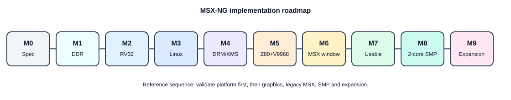

# 10 - Implementation roadmap

## Milestone M0 - specification repository

- architecture frozen enough to code;
- address map defined;
- board target documented;
- resource budget documented;
- risks listed.

## M1 - 138K hardware bring-up

- clocks;
- DDR3;
- UART;
- memory test.

## M2 - soft RISC-V bare metal

- one hart;
- interrupts;
- DDR execution;
- JTAG/debug if available.

## M3 - Linux text mode

- Sv32;
- OpenSBI;
- Linux;
- Buildroot shell.

## M4 - Linux graphics

- HDMI framebuffer;
- DRM/KMS;
- compositor;
- native GUI apps.

## M5 - MSX legacy island

- Z80;
- MSX bus;
- V9968;
- BIOS/ROM boot.

## M6 - MSX in a Linux window

- legacy plane;
- window/fullscreen;
- input focus;
- audio routing.

## M7 - usable workstation

- SD rootfs;
- file manager;
- terminal;
- networking strategy;
- update mechanism.

## M8 - SMP

- 2 native harts;
- coherent memory;
- Linux SMP.

## M9 - expansion

- 25K expansion modules;
- multi-FPGA link profile;
- optional 3D;
- additional legacy machines/cores.

## Suggested GitHub issue backlog

1. `board: identify 138K silicon revision and flash size`
2. `board: freeze known-good 138K constraints`
3. `ddr: standalone 1GB memory-test bitstream`
4. `soc: define CSR/interrupt/timer block`
5. `cpu: integrate Linux-capable RV32 reference core`
6. `boot: OpenSBI hello-world`
7. `linux: first kernel boot on UART`
8. `buildroot: reproducible rv32 image`
9. `video: 720p DDR framebuffer`
10. `drm: primary plane driver`
11. `gui: Weston/minimal compositor bring-up`
12. `legacy: Z80 wrapper`
13. `legacy: V9968 integration`
14. `legacy: host control mailbox`
15. `gpu: legacy overlay plane`
16. `input: keyboard focus native/legacy`
17. `audio: first shared mixer`
18. `smp: second hart`
19. `expansion: define FPGA-module bus`
20. `docs: publish v0.1 hardware/software ABI`
