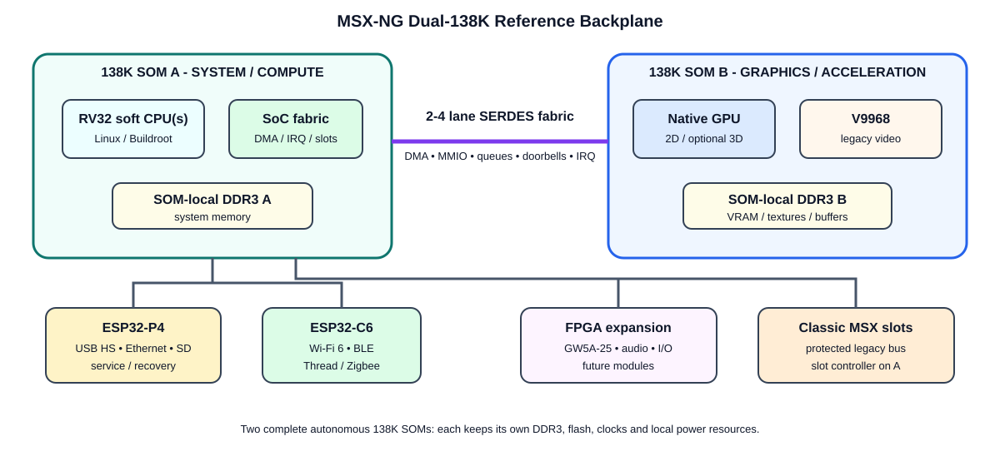

# 16 - Dual-138K Reference Backplane

## Purpose

This document defines a **future MSX-NG implementation profile** based on a custom carrier/backplane with **two removable Tang Mega/Console-class 138K modules**, an **ESP32-P4 services processor**, an **ESP32-C6 radio processor**, classic MSX cartridge slots, and modern FPGA expansion sockets.

It is **not required for MSX-NG v0.1**. The first implementation remains a single 138K. The purpose of this profile is to define a scalable hardware path once the single-FPGA machine works.



## Fundamental hardware assumption: two complete SOMs

The two main 138K devices are **not bare FPGAs on the motherboard**. They are complete **Tang Mega 138K SOMs**, and each SOM must be treated as an autonomous compute module with its **own local resources**.

Each SOM contributes, independently:

- GW5AST-138 FPGA fabric;
- its own onboard DDR3;
- its own SPI flash / configuration storage;
- its own local power conversion and decoupling already present on the module;
- its own clocking resources and local oscillator inputs as provided by the SOM;
- its own JTAG/configuration path;
- any additional onboard resources exposed by that SOM revision.

The carrier/backplane must **not try to merge, share, or recreate those local resources**. Its job is instead to provide:

- power input and sequencing for both SOMs;
- reset coordination;
- reference clocks only where an inter-module link requires them;
- the high-speed SOM-to-SOM fabric;
- classic MSX slots;
- modern FPGA expansion sockets;
- ESP32-P4 / ESP32-C6 service connectivity;
- external HDMI/USB/Ethernet/audio connectors where they are not already directly usable from the SOMs.

Conceptually:

```text
       COMPLETE SOM A                          COMPLETE SOM B
 +--------------------------+            +--------------------------+
 | GW5AST-138               |            | GW5AST-138               |
 | own DDR3                 |            | own DDR3                 |
 | own flash                |            | own flash                |
 | own clocks               |            | own clocks               |
 | own local power          |            | own local power          |
 | own configuration/debug  |            | own configuration/debug  |
 +------------+-------------+            +-------------+------------+
              |                                            |
              +====== high-speed FPGA fabric ==============+
                           carrier/backplane
```

This distinction is important: **the motherboard links two self-contained FPGA computers; it does not build two FPGA computers from discrete parts.**

## Design goals

1. Keep both 138K modules replaceable.
2. Use two complete 138K SOMs, each retaining its own onboard DDR3, flash, clocking, local power resources and configuration path.
3. Connect both FPGAs with a **dedicated high-speed point-to-point fabric**.
4. Avoid transparent cache coherence between the two FPGAs in the first generation.
5. Add a separate **services plane** using ESP32-P4 + ESP32-C6.
6. Provide expansion sockets for smaller FPGA modules such as GW5A-25.
7. Keep classic MSX slots physically separate from the modern FPGA expansion bus.
8. Preserve the same software-visible MSX-NG APIs across single- and dual-FPGA implementations.

## Proposed architecture

```text
 +--------------------------------------------------------------------------+
 |                         MSX-NG DUAL-138K BACKPLANE                        |
 |                                                                          |
 |  Classic MSX cartridge slots                                             |
 |  [S1] [S2] [S3] [S4] [S5] [S6] [S7] [S8]                               |
 |                    |                                                     |
 |                    +------- protected MSX slot controller --------+      |
 |                                                                    |      |
 | +-----------------------+       2-4 lane SERDES      +------------------+ |
 | | 138K MODULE A         |<==========================>| 138K MODULE B    | |
 | | SYSTEM / COMPUTE      |   DMA / MMIO / queues     | GRAPHICS / ACCEL | |
 | |                       |                            |                  | |
 | | RV32 soft CPU(s)      |                            | Native 2D GPU    | |
 | | Linux / Buildroot     |                            | V9968            | |
 | | System DDR3           |                            | compositor       | |
 | | storage / slots       |                            | optional 3D      | |
 | +-----------+-----------+                            | Video DDR3       | |
 |             |                                        +--------+---------+ |
 |             +-------------- services fabric ------------------+           |
 |                                  |                                        |
 |                           +------+-------+                                |
 |                           | ESP32-P4     |                                |
 |                           | USB/Eth/SD   |                                |
 |                           | recovery/I/O |                                |
 |                           +------+-------+                                |
 |                                  |                                        |
 |                           +------+-------+                                |
 |                           | ESP32-C6     |                                |
 |                           | Wi-Fi/BLE/   |                                |
 |                           | 802.15.4     |                                |
 |                           +--------------+                                |
 |                                                                          |
 |     FPGA EXP A           FPGA EXP B            FPGA EXP C                 |
 |     [GW5A-25]            [GW5A-25]             [future]                   |
 +--------------------------------------------------------------------------+
```

# 1. Recommended division of work

## Module A - SYSTEM / COMPUTE

Primary responsibilities:

- RV32 soft CPU cluster;
- Linux + Buildroot;
- MMU, interrupt controller, timers and DMA;
- system DDR ownership;
- classic MSX slot controller;
- storage and filesystem ownership;
- expansion-module discovery and management;
- high-speed bridge to Module B;
- optional legacy-Z80 control plane.

## Module B - GRAPHICS / ACCELERATION

Primary responsibilities:

- native 2D GPU;
- hardware compositor;
- V9968;
- HDMI/display scanout;
- local video DDR;
- graphics DMA;
- optional RasterIX/3D;
- additional legacy cores;
- optional DSP/compute accelerators.

The second 138K should behave as a **programmable GPU/accelerator**, not merely as a passive VDP.

# 2. Inter-FPGA high-speed link

Do **not** use a multidrop shared electrical bus. Use point-to-point full-duplex SERDES.

The GW5AST-138 family provides dedicated multi-gigabit transceivers, but the exact number physically available on the Tang module depends on package and connector exposure. **The Tang 138K SOM schematic and BTB connector pinout must be verified before PCB layout.**

## Baseline

Route **2 full-duplex lanes** between the modules:

```text
A TX0+/-  -------------------->  B RX0+/-
A RX0+/-  <--------------------  B TX0+/-

A TX1+/-  -------------------->  B RX1+/-
A RX1+/-  <--------------------  B TX1+/-
```

This requires:

- **8 high-speed PCB traces**
- **4 controlled-impedance differential pairs**

Also route:

- reference clock infrastructure;
- reset;
- link-present;
- optional sideband IRQ;
- strong ground reference around the link.

## Initial line rate

Start at **6.25 Gb/s per lane**.

With 8b/10b-like coding:

| Active lanes | Approx. useful bandwidth per direction |
|---:|---:|
| 1 | ~625 MB/s |
| 2 | ~1.25 GB/s |
| 4 | ~2.5 GB/s |

These are planning values before higher-level protocol overhead.

## Future-proof PCB

If the Tang module exposes sufficient transceiver lanes, physically route **4 lanes** even if the first FPGA image enables only 2.

# 3. MSX-NG FPGA Fabric protocol

Keep physical transport and software-visible bus separate.

## Transport layer

Candidates:

- GOWIN RoraLink;
- custom lightweight 8b/10b packet link;
- CRC;
- link training;
- sequence numbers;
- flow control;
- lane bonding later.

## Logical packet types

```text
READ32
WRITE32
READ_BLOCK
WRITE_BLOCK
DMA_SUBMIT
DMA_COMPLETE
DOORBELL
IRQ
MESSAGE
RESET_ENDPOINT
ENUMERATE
TRACE
```

## Draft remote address aperture

```text
0x3000_0000 - 0x30FF_FFFF   Remote GPU MMIO
0x3100_0000 - 0x31FF_FFFF   Remote V9968/video MMIO
0x3200_0000 - 0x32FF_FFFF   Remote DMA queues
0x3300_0000 - 0x33FF_FFFF   Remote service/expansion devices
```

# 4. Memory architecture

Each 138K keeps its own local DDR:

```text
System DDR A -> 138K A -> SERDES FABRIC -> 138K B -> Video DDR B
```

Do **not** initially expose the two DDR memories as one transparent coherent address space.

Use:

- explicit DMA buffers;
- descriptor rings;
- ownership transitions;
- fences;
- completion interrupts.

This model is closer to a conventional CPU + discrete GPU and is substantially easier to validate.

# 5. Linux graphics model

Linux remains on Module A. Module B becomes a remote GPU.

```text
Linux app
   |
Wayland
   |
DRM/KMS driver
   |
GPU command / DMA queues
   |
FPGA Fabric
   |
138K Module B
   |
2D GPU + V9968 + compositor
   |
HDMI
```

The driver-facing API should remain similar whether the GPU resides:

- in the same FPGA; or
- in the second 138K.

That abstraction is important for portability.

# 6. ESP32-P4 services plane

The P4 complements MSX-NG but is **not the main CPU**.

Candidate responsibilities:

- USB High-Speed host/device;
- keyboard/mouse/gamepad aggregation;
- Ethernet/service networking;
- SD/MMC services;
- board UI;
- update staging;
- diagnostics;
- recovery console;
- optional USB gadget/debug mode.

Preferred link to Module A:

1. 8/16-bit source-synchronous parallel link;
2. SDIO-like interface;
3. fast SPI for an early revision.

Do not consume the main 138K-to-138K SERDES lanes for P4 traffic.

# 7. ESP32-C6 connectivity plane

The C6 complements the P4 with:

- Wi-Fi 6;
- Bluetooth LE;
- IEEE 802.15.4;
- Thread/Zigbee.

Recommended initial topology:

```text
138K A <-> ESP32-P4 <-> ESP32-C6 <-> Wi-Fi / BLE / 802.15.4
```

A later board can provide a direct fallback link from C6 to Module A if desirable.

# 8. Modern FPGA expansion bus

Provide **2-3 modern expansion sockets** for smaller FPGA modules such as GW5A-25.

Possible uses:

- OPL4 / advanced audio;
- PSG/SCC/FM engines;
- MIDI;
- specialty USB;
- networking accelerator;
- capture/video input;
- machine-specific legacy core;
- bus analyzer;
- experimental coprocessor.

## Connector philosophy

A **40-50 contact connector** is sufficient if the interface is packetized rather than a giant parallel address/data bus.

Suggested contact budget:

| Group | Contacts |
|---|---:|
| power | 6-8 |
| ground | 10-14 |
| fast link / LVDS pairs | 4-8 |
| clock pair | 2 |
| reset / IRQ / present | 3-4 |
| GPIO / sideband | 8-12 |
| JTAG/debug | 4 |
| reserved | remainder |

# 9. Classic MSX cartridge slots

Classic MSX slots remain a separate compatibility bus.

Module A controls:

- /SLTSL;
- /WAIT;
- /INT;
- bus direction;
- bus conflicts;
- timing;
- optional electrical isolation.

The classic slot bus must not be electrically conflated with the modern FPGA expansion bus.

# 10. Alternative dual-138K profiles

## A. Recommended

**138K A:** Linux / RV32 / system / slots / storage.

**138K B:** GPU / V9968 / HDMI / graphics DDR / accelerators.

## B. Legacy-heavy

**138K A:** Linux/native system.

**138K B:** complete MSX machine plus additional retro systems.

## C. Compute-heavy

**138K B:** vector/DSP/RV32/AI accelerators with a reduced graphics role.

# 11. Capacity perspective

Two 138K-class devices provide approximately:

- **276,480 LUT4** aggregate;
- **596 DSP blocks** aggregate;
- two independent BSRAM pools;
- potentially about **2 GB aggregate DDR** if each module has 1 GB.

They are still **two physical FPGAs**, not one coherent giant FPGA. That is a feature because it creates explicit modular boundaries and allows independent upgrades.

# 12. First custom carrier recommendation

## Revision A

- 2 removable 138K modules;
- 2-lane full-duplex FPGA fabric;
- PCB routing provision for 4 lanes if possible;
- ESP32-P4;
- ESP32-C6;
- 2 modern FPGA expansion sockets;
- 4 classic MSX slots initially if 8 makes routing unnecessarily difficult;
- HDMI;
- USB;
- Ethernet;
- SD;
- stereo audio;
- JTAG/UART/debug;
- clock generator;
- power monitoring.

## Revision B

After signal-integrity and thermal validation:

- 8 classic MSX slots;
- more modern expansion sockets;
- more SERDES lanes;
- optional M.2/PCIe experiments;
- HDMI input;
- advanced audio/XMOS if it proves useful.

# 13. Implementation sequence before designing the PCB

## D1 - one-lane bench link

- PRBS;
- error counters;
- packet loopback;
- DMA block transfer.

## D2 - two lanes

- lane bonding;
- sustained bidirectional DMA;
- CRC/error injection;
- long-duration testing.

## D3 - remote framebuffer

- Linux runs on A;
- framebuffer is transferred to B;
- B outputs it over HDMI.

## D4 - remote GPU

- command queue;
- GPU-local DDR;
- native KMS plane.

## D5 - V9968 on B

- legacy control on A;
- V9968 rendering on B;
- MSX appears as a desktop plane/window.

## D6 - P4/C6 services plane

Integrate USB/network/recovery only after the core FPGA fabric is stable.

## D7 - custom carrier PCB

At this point the PCB becomes an integration project rather than an architecture experiment.

# 14. Architecture rule

The Dual-138K backplane is an **optional implementation profile**, not an MSX-NG requirement.

The same software-visible MSX-NG concepts should remain portable to:

- single 60K;
- single 138K;
- Z020 programmable logic;
- dual 138K;
- future larger FPGA systems.
